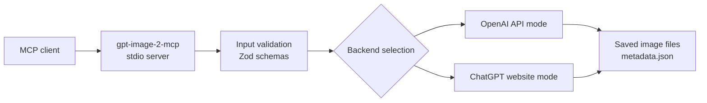

# @ramlyburger/gpt-image-2-mcp

<p align="center">
  <a href="https://www.npmjs.com/package/@ramlyburger/gpt-image-2-mcp"></a>
  <a href="https://www.npmjs.com/package/@ramlyburger/gpt-image-2-mcp"></a>
  <a href="https://nodejs.org/"></a>
  <a href="https://modelcontextprotocol.io/"></a>
  <a href="./LICENSE"></a>
</p>

<p align="center">
  
</p>

Turn any MCP-compatible AI client into an image generator. Send a normal prompt, choose a backend mode, and get real saved image files back.

## Popularity

<p align="center">
  
</p>

PulseMCP: [https://www.pulsemcp.com/servers/ramlyburger-gpt-image-2](https://www.pulsemcp.com/servers/ramlyburger-gpt-image-2)

## 🖼️ What It Does

- ✍️ **Prompt in:** ask for an image from your MCP client.
- ⚙️ **MCP server runs:** `gpt-image-2-mcp` handles the image request.
- 💾 **Files out:** every result includes `output_dir`, `image_path`, and metadata.
- 🔐 **No ChatGPT API key needed** in `chatgpt-web` mode. You only need a ChatGPT account and a successful sign-in at [chatgpt.com](https://chatgpt.com/).

<p align="center">
  
</p>

## 🚀 Quick Start

Add the server to your MCP client:

```json
{
  "mcpServers": {
    "gpt-image-2": {
      "command": "npx",
      "args": ["-y", "@ramlyburger/gpt-image-2-mcp"],
      "env": {
        "GPT_IMAGE_BACKEND": "chatgpt-web"
      }
    }
  }
}
```

That is enough for the ChatGPT website mode. The first `generate_image` call opens ChatGPT so you can sign in or complete verification (or import your Chrome sign-in, see below). After that, the local profile is reused across restarts.

For direct API generation, set `OPENAI_API_KEY` and change `GPT_IMAGE_BACKEND` to `api`.

## 🔌 Client Setup

Build a local checkout first (`npm install && npm run build`), then register `dist/index.js` with each client. Replace `/path/to/gpt-image-2-mcp` with your checkout path. ChatGPT website generations can take several minutes, so raise the tool timeout where the client has one (Codex and Grok default to 60 seconds).

**Claude Code**

```sh
claude mcp add -s user gpt-image-2 -e GPT_IMAGE_BACKEND=chatgpt-web -- node /path/to/gpt-image-2-mcp/dist/index.js
```

**Codex**

```sh
codex mcp add gpt-image-2 --env GPT_IMAGE_BACKEND=chatgpt-web -- node /path/to/gpt-image-2-mcp/dist/index.js
```

Then add `tool_timeout_sec = 600` under `[mcp_servers.gpt-image-2]` in `~/.codex/config.toml`.

**Antigravity CLI (`agy`)**

```sh
agy mcp add --env GPT_IMAGE_BACKEND=chatgpt-web gpt-image-2 node /path/to/gpt-image-2-mcp/dist/index.js
```

**Grok CLI**

```sh
grok mcp add -s user -e GPT_IMAGE_BACKEND=chatgpt-web gpt-image-2 -- node /path/to/gpt-image-2-mcp/dist/index.js
```

Then add `tool_timeout_sec = 600` under `[mcp_servers.gpt-image-2]` in `~/.grok/config.toml`. `grok mcp doctor` checks the handshake.

All clients share one ChatGPT browser profile, and one session uses it at a time. The browser starts on the first `chatgpt-web` call and closes after `CHATGPT_WEB_IDLE_CLOSE_SECONDS` (default 600) without a call. When another gpt-image-2 session holds the profile, a call asks that session to hand the profile over and waits up to its `timeout_seconds`; the holding session acknowledges the request and closes its browser as soon as it is not running a call (including when it is only waiting for sign-in). If nothing acknowledges the request within 10 seconds, the profile is held by some other program and the call fails with a message saying so. `browser_visibility` with `start_browser` waits up to 30 seconds for a hand-off.

### Reuse Your Chrome Sign-In

Instead of signing in inside the MCP browser window, copy the ChatGPT sign-in from your everyday Chrome:

1. Sign in at [chatgpt.com](https://chatgpt.com/) in your normal Chrome (version 144 or newer).
2. Open `chrome://inspect/#remote-debugging` there and turn on "Allow remote debugging for this browser instance".
3. Run `node /path/to/gpt-image-2-mcp/dist/index.js import-chrome-cookies` (Node.js 22 or newer) and accept Chrome's prompt. If a gpt-image-2 session holds the MCP profile, the command asks it to hand the profile over and waits up to 60 seconds. It reports whether the imported session is signed in.

The command copies only `chatgpt.com` and `openai.com` cookies into the MCP profile (`CHATGPT_WEB_PROFILE_DIR`). Set `CHROME_USER_DATA_DIR` to read from a Chrome install outside the default location. This is a one-time step: the cookies are saved in the MCP profile, every browser the MCP starts reuses them, and ChatGPT renews the session while it is used. Run the command again only if `backend_status` stops reporting a ready, signed-in session. You can turn remote debugging off again afterwards.

## 🧭 Pick A Mode

| Mode | What you need | Best when | Notes |
| --- | --- | --- | --- |
| `chatgpt-web` | A ChatGPT account and sign-in at `chatgpt.com` | You want a simple setup without a ChatGPT API key | Good beginner default |
| `api` | `OPENAI_API_KEY` | You want the direct API path | Uses `gpt-image-2` |
| `auto` | Preferably an API key; otherwise a usable ChatGPT website session | You want API first with fallback behavior | Tries API first, then falls back only when the API backend is unavailable |

## 🎬 Demo

[](./assets/demo.mp4)

Click the GIF to open the full MP4.

## 🧰 Tool Surface

- `generate_image(prompt, backend?, n?, size?, quality?, output_format?, reference_images?, conversation_mode?, conversation_url?, return_images?, timeout_seconds?)`
- `backend_status(backend?)`
- `browser_visibility(action?, start_browser?)`
- `list_generations(limit?)`
- `collect_images(conversation_url, n?, return_images?, timeout_seconds?)`

Backend values are `api`, `chatgpt-web`, or `auto`.

- `reference_images`: absolute paths of local PNG, JPEG, or WebP files (up to 10, 50 MB each). The API backend sends them to the image edit endpoint; the ChatGPT website backend uploads them to the chat.
- `conversation_url`: the `conversation_url` (a `https://chatgpt.com/c/...` address) from an earlier ChatGPT website result, to keep refining in that chat. An empty value is treated as not set. `conversation_mode="continue"` uses the chat that is open, or the last chat this server session used; when there is none, the result warns that a new chat was started. Before sending, the call waits for the chat history to load and for any reply that is still being generated; if that reply is still running at the deadline, the prompt is not sent. The API backend ignores both and says so in `warnings`.
- `return_images`: `inline` (default) returns the image data as MCP image content; `none` returns only paths and metadata.
- `timeout_seconds`: the overall limit, including browser start and sign-in waits. Cancelling the call from the client stops the work.
- `n` is the number of images on the API backend and the maximum number saved on the ChatGPT website backend. `size`, `quality`, and `output_format` apply to the API backend; the ChatGPT website backend lists them in `warnings` when it ignores them.
- `list_generations` returns earlier outputs (newest first) with prompt, backend, image paths, and `conversation_url`.
- `collect_images` opens a ChatGPT conversation without sending a prompt and saves its most recent generated images. Errors from timed-out or text-only ChatGPT calls include the conversation URL for this, and `backend_status` reports the session's `last_conversation_url`. If the latest reply is still being generated, it waits up to its `timeout_seconds` and then returns an error asking to call again later; if the latest reply has no image, it saves the most recent earlier image and says so in `warnings`.

During `generate_image` and `collect_images` calls the server sends MCP progress notifications every 5 seconds when the client requests progress.

## 📄 Technical Reference

The section below is the implementation-oriented view.

### Figure 1. System Model



<p align="center">
  
</p>

### Abstract

`gpt-image-2-mcp` is a small TypeScript MCP server that exposes image generation through a narrow tool contract. The server validates MCP tool input, resolves the requested backend, persists generated artifacts to disk, and returns structured metadata plus image content to the caller.

### Method

The implementation follows a five-stage pipeline:

1. parse and validate MCP tool input
2. resolve the backend from `api`, `chatgpt-web`, or `auto`
3. execute the selected image-generation path
4. write generated images and `metadata.json` to a prompt-derived output directory
5. return `output_dir`, `image_path`, `images`, and backend metadata

The `auto` mode attempts the API backend first and falls back to `chatgpt-web` only when the API backend is unavailable.

### Artifact Model

Each generation creates one output directory. Images are written as numbered files such as `image-01.png`, and metadata is written beside them.

Default output roots:

```text
Windows: %LOCALAPPDATA%\gpt-image-2-mcp\output\chatgpt-images
macOS:   ~/Library/Application Support/gpt-image-2-mcp/output/chatgpt-images
Linux:   ${XDG_DATA_HOME:-~/.local/share}/gpt-image-2-mcp/output/chatgpt-images
```

Operational notes:

- `backend_status` returns the effective `output_root`
- `generate_image` returns `output_dir`, `image_path`, and the full `images` array
- image filenames are numbered within one output directory: `image-01`, `image-02`, and so on
- output directory names are `<timestamp>-<prompt slug>`, with `-2`, `-3`, ... added when that name already exists
- metadata is written as JSON alongside the image files, including the request parameters (API) or the conversation URL (ChatGPT website)
- `GPT_IMAGE_OUTPUT_DIR` replaces the default output root

### ChatGPT Website Mode

Run the server in ChatGPT website mode:

```powershell
$env:GPT_IMAGE_BACKEND = "chatgpt-web"
node dist/index.js
```

The first `generate_image` call (or `browser_visibility` with `start_browser`) opens ChatGPT in Chrome or Edge. If the profile is not signed in, the window stays visible so you can sign in or complete verification; the call waits up to its `timeout_seconds`. The session counts as ready only when `chatgpt.com/api/auth/session` reports a signed-in user. If ChatGPT shows a verification check during a generation, the window is shown again. No ChatGPT API key is required for this mode.

The local ChatGPT sign-in profile is stored under the same per-user app data directory by default. Override it with:

```powershell
$env:CHATGPT_WEB_PROFILE_DIR = "C:\path\to\profile"
```

Optional settings:

```powershell
$env:CHATGPT_WEB_LOGIN_TIMEOUT_SECONDS = "900"
$env:CHATGPT_HIDE_WINDOW = "0"
$env:CHATGPT_WEB_IDLE_CLOSE_SECONDS = "600"
$env:CHATGPT_WEB_EAGER_START = "1"
$env:CHROME_PATH = "C:\path\to\chrome.exe"
```

- `CHATGPT_HIDE_WINDOW` defaults to enabled. The ChatGPT window stays visible for sign-in or verification, then hides once a signed-in page is ready. Use `0` to keep it visible. `browser_visibility` `show` or `hide` applies until the browser closes; the next browser start uses this setting again.
- `CHATGPT_WEB_LOGIN_TIMEOUT_SECONDS` limits how long a started browser waits for sign-in (default 900). A `generate_image` call itself stops waiting at its own `timeout_seconds`; `browser_visibility` with `start_browser` returns once the window is open.
- `CHATGPT_WEB_IDLE_CLOSE_SECONDS` closes the browser after that many seconds without a call (default 600, `0` keeps it open, at most 2147483).
- `CHATGPT_WEB_EAGER_START=1` starts the browser when the server starts instead of on the first call.
- `CHROME_PATH` points at the browser executable when Chrome is not found through its standard install.

The ChatGPT website backend returns one image per call, typically in 20 seconds to a few minutes. A reply without an image (for example a refusal, a usage-limit message, or a clarifying question) ends the call with ChatGPT's reply text instead of waiting for the timeout. Each call creates a chat in the signed-in ChatGPT account's history. Output folders are created only for saved images; when a call reaches its timeout, a folder with a `diagnostic-timeout.png` screenshot is created instead. Calls in one server session run one at a time, and time spent waiting for an earlier call counts against `timeout_seconds`.

### API Mode

Run the server in direct API mode:

```powershell
$env:OPENAI_API_KEY = "sk-..."
$env:GPT_IMAGE_BACKEND = "api"
node dist/index.js
```

This mode uses the configured OpenAI image model directly. By default the model is `gpt-image-2` (override with `GPT_IMAGE_MODEL`), and the selected output format can be `png`, `jpeg`, or `webp`. `OPENAI_BASE_URL` points the client at a compatible endpoint. Requests are not retried and are limited by `timeout_seconds`.

### Tool Contract

`generate_image` returns a structured result with these important fields:

- `status`
- `requested_backend`
- `backend`
- `fallback_from`
- `prompt`
- `output_dir`
- `image_path`
- `images`
- `conversation_url` (ChatGPT website backend)
- `warnings`
- `metadata`

`backend_status` returns readiness and configuration information for the selected backend or for both backends when `auto` is requested, plus `server_version` and configuration `warnings` (for example an unrecognized `GPT_IMAGE_BACKEND` value or a setting that is not a valid number or on/off value).

`browser_visibility` controls the visibility of the ChatGPT window and can also start the ChatGPT session when requested.

### Local Development

The TypeScript MCP server is the only supported entry point.

Install and build:

```powershell
npm install
npm run build
```

Useful local commands:

```powershell
npm run typecheck
npm run build
npm run start
npm test
npm run test:live
```

`npm test` builds the server and runs three offline suites:

- `scripts/smoke-test.mjs` drives the server over MCP stdio against a local mock of the OpenAI image endpoint: tool list and annotations, backend status, browser visibility, API generation, reference-image edits, output-folder uniqueness, `return_images`, timeouts, cancellation, retries, progress notifications, `list_generations`, and configuration warnings.
- `scripts/web-fixture-test.mjs` runs the ChatGPT website page logic in headless Chrome against a local fixture page (`scripts/fixture/`) served at `https://chatgpt.com/`: signed-in detection, preview versus final image, text-only and refusal replies, reference uploads, dialogs, late-rendering chat history, `continue` into a reply that is still being generated, the send-button fallback, verification interstitials and chat titles, cancellation, the deadline, and collecting images from a conversation (including a latest reply without an image or one still being generated).
- `scripts/web-session-test.mjs` runs the built server over MCP stdio with `scripts/fixture/preload.mjs`, which makes its browser headless and routes it to the fixture: warnings, queued calls and cancellation, idle close, `continue` after idle close, `collect_images`, `browser_visibility` during sign-in, and the profile hand-off between server processes (including stale requests, a waiter that gives up, a profile held by another program, and a hand-off requested by `browser_visibility`), and `import-chrome-cookies` reading cookies from a separate headless Chrome and taking the profile over.

The ChatGPT website suites need Chrome installed.

`npm run test:live` sends four real prompts through a signed-in ChatGPT profile (new chat, a second chat, `conversation_url` back to the first chat, `reference_images`), then checks `collect_images`, `list_generations`, and the idle browser close. Close other MCP sessions that use the profile first.

### Repository Notes

- `src/index.ts` registers the MCP tools
- `src/config.ts` resolves environment-driven configuration
- `src/backends/` contains backend implementations and selection logic
- `src/output.ts` is responsible for output-directory naming and file writes
- `src/importChromeCookies.ts` implements the `import-chrome-cookies` command

The public MCP surface stays intentionally small while backend-specific behavior remains isolated in the backend layer.
